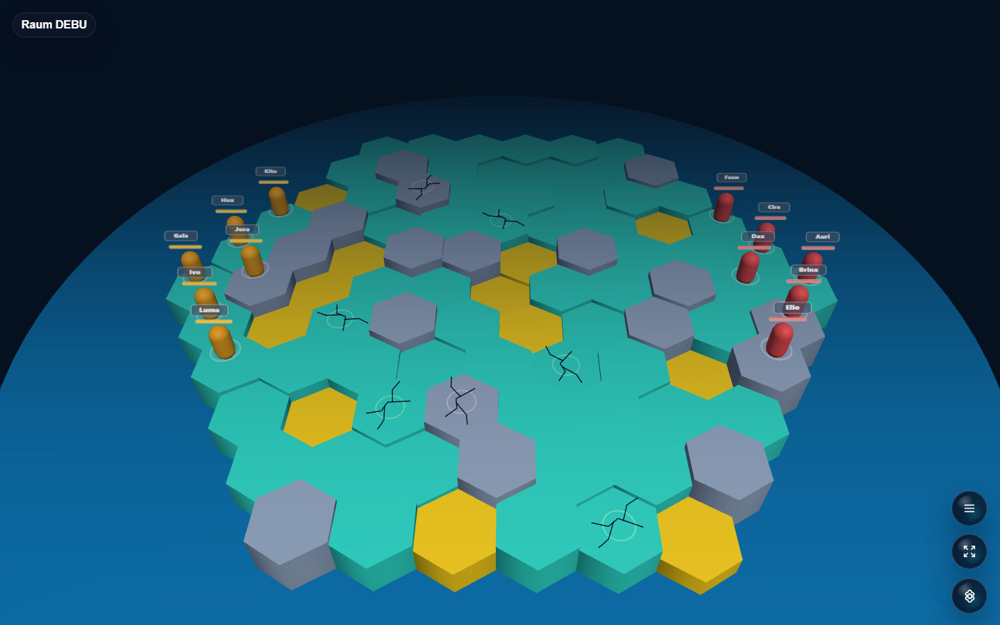
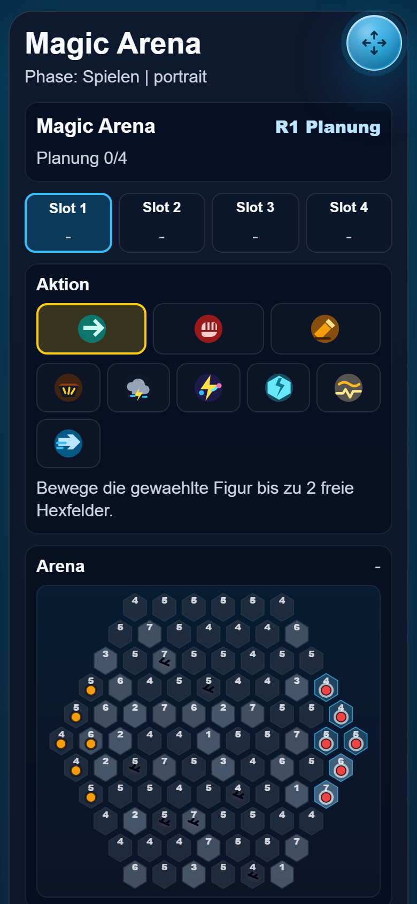

# Magic Arena

Recommended alpha 3D hex tactics game for Open Party Lab with cards, collapsing arenas, and hidden planning.





## Status

Recommended alpha. The core loop is playable: players plan actions on phone controllers, resolve card and base actions in slot order, and fight on a shrinking 3D hex arena. Needs more balancing, card clarity, and longer playtest coverage.

## Run Through Open Party Lab

This repo is not a standalone app. Run it through the Open Party Lab platform.

Recommended layout:

```text
Open-Party-Lab/
  local-games/
    magic-arena/
```

From the Platform repo:

```bash
npm install
npm run games:sync-local
npm run dev:all
```

The Platform loads this game only when the repo exists locally and `npm run games:sync-local` links it. Missing optional games are skipped.

## GitHub Metadata

Description:

```text
Recommended alpha 3D hex tactics game for Open Party Lab with cards, collapsing arenas, and hidden planning.
```

Suggested topics:

```text
open-party-lab party-game browser-game threejs phaser typescript local-multiplayer tactics-game 3d-game magic-arena
```

## Package Entrypoints

- `@open-party-lab/game-magic-arena/manifest`
- `@open-party-lab/game-magic-arena/protocol`
- `@open-party-lab/game-magic-arena/server`
- `@open-party-lab/game-magic-arena/host`
- `@open-party-lab/game-magic-arena/controller`

The Platform should import only these public entrypoints.

## Development Checks

```bash
npm install
npm run typecheck
npm run test:rules
npm run build
npm run pack:dry-run
```

For visual checks, start Open Party Lab, add virtual controllers when needed, and capture host/controller screenshots through a browser.

## License

Code is licensed under the Apache License 2.0. See [LICENSE](LICENSE).

Assets, generated media, prompts, and third-party references may need separate rights review before public store distribution.
